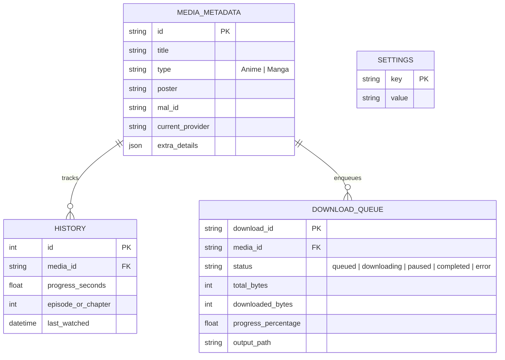

# Backend Core & Services

## 1. Directory Structure

```text
backend/
├── download.js           # Core downloader entry and bulk execution orchestrator
├── routes/               # Express modular route definitions
│   ├── index.js          # Main router mounting and SPA route handler
│   ├── system.js         # Settings, logs, directory info, updates
│   ├── media.js          # Anime/Manga search, streams, chapters, providers
│   ├── library.js        # Local library, watch history, bookmarks, tags
│   ├── downloads.js      # Queue management, pause/resume, progress events
│   ├── mal.js            # MyAnimeList OAuth, sync, user profiles
│   └── update.js         # Android APK update checker and installer
└── utils/                # Service layer, storage, parsers, and utilities
    ├── db.js             # SQLite abstraction layer (sqlite3 / node:sqlite)
    ├── queue.js          # Persistent asynchronous download queue manager
    ├── downloader.js     # Multi-threaded file streaming, HLS & CBZ compiler
    ├── scrapper.js       # HTTP scraping helper, headers, proxy agent
    ├── AnimeManga.js     # Provider aggregator (Gogo, Zoro, MangaDex, etc.)
    ├── domainConcurrency.js # Per-domain connection rate-limiting and circuit-breaker
    ├── mpvPlayer.js      # Native MPV player socket and process controller
    ├── mal.js            # MAL API v2 client and PKCE token manager
    ├── AppLogger.js      # Structured circular in-memory and file logging
    └── ...
```

---

## 2. API Routes Specification

All API endpoints are mounted under `/api` (or root prefix handled in [`backend/routes/index.js`](../backend/routes/index.js)):

| Endpoint Group | File                                             | Key Methods                                                    | Description                                                                                    |
| :------------- | :----------------------------------------------- | :------------------------------------------------------------- | :--------------------------------------------------------------------------------------------- |
| **Media**      | [`media.js`](../backend/routes/media.js)         | `GET /search`, `GET /info`, `GET /watch`, `GET /read`          | Resolves anime episodes, video stream links (HLS/MP4), manga chapter image lists from scrapers |
| **Downloads**  | [`downloads.js`](../backend/routes/downloads.js) | `POST /download`, `GET /queue`, `POST /cancel`, `POST /retry`  | Enqueues episodes/chapters, streams download progress, controls queue lifecycle                |
| **Library**    | [`library.js`](../backend/routes/library.js)     | `GET /library`, `POST /bookmark`, `GET /history`, `POST /tags` | Interacts with local SQLite database to persist user watch history, bookmarks, and local files |
| **System**     | [`system.js`](../backend/routes/system.js)       | `GET /settings`, `POST /settings`, `GET /logs`, `POST /folder` | System settings, local directory pickers, system specs, Discord RPC config                     |
| **MAL**        | [`mal.js`](../backend/routes/mal.js)             | `GET /mal/auth`, `GET /mal/callback`, `POST /mal/sync`         | PKCE OAuth authentication with MyAnimeList, user list synchronization                          |

---

## 3. Database Layer & Schema

The database abstraction [`backend/utils/db.js`](../backend/utils/db.js) provides a resilient interface supporting native SQLite bindings (`better-sqlite3`, `sqlite3`, or Node 22+ built-in `node:sqlite`).

### Key Database Tables



---

## 4. Downloader Engine & Concurrency Management

Download operations are handled by [`backend/utils/downloader.js`](../backend/utils/downloader.js) and coordinated by [`backend/utils/queue.js`](../backend/utils/queue.js):

### 4.1 Features

- **HLS Segment Downloader**: Fetches `.m3u8` playlists, downloads TS video fragments concurrently, and decrypts AES-128 if keys are specified.
- **FFmpeg Transcoding & Remuxing**: Merges downloaded video streams with subtitle tracks (`.vtt`, `.ass`) into clean `.mp4` or `.mkv` containers.
- **CBZ Manga Packager**: Fetches individual manga chapter page images, caches them locally, and compiles them into `.cbz` archive formats.
- **Domain Concurrency Limiter** ([`backend/utils/domainConcurrency.js`](../backend/utils/domainConcurrency.js)): Dynamically caps simultaneous TCP sockets per CDN/scraper hostname, monitoring 429/503 responses to trigger exponential backoff.
