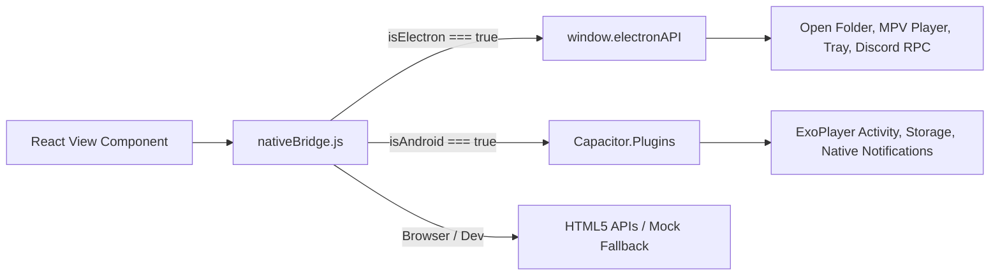

# Frontend Architecture

## 1. Directory Structure

The user interface is built with React 19 and bundled using Vite.

```text
gui/
├── index.html            # Single page entry with font preloads & meta tags
├── vite.config.js        # Vite bundling and development server proxy configuration
├── src/
│   ├── main.jsx          # React DOM entry point
│   ├── App.jsx           # Master route router, global modals, and layout coordinator
│   ├── index.css         # Global Tailwind and custom theme styles
│   ├── mobile.css        # Responsive mobile styling for Android displays
│   ├── components/       # UI components & views
│   │   ├── Sidebar.jsx           # Main navigation drawer
│   │   ├── Catalog.jsx           # Anime/Manga discovery, filter & search
│   │   ├── InfoView.jsx          # Detailed media overview, episodes, chapter list
│   │   ├── VideoPlayer.jsx       # Custom HTML5 / HLS.js video streaming player
│   │   ├── MangaReader.jsx       # Multi-mode manga reader (webtoon, single, double page)
│   │   ├── DownloadsTracker.jsx  # Active downloads manager, speed and progress meters
│   │   ├── Marketplace.jsx       # Provider extensions and addon manager
│   │   ├── LogsView.jsx          # Application runtime log inspector
│   │   ├── catalog/              # Catalog specific subcomponents
│   │   ├── player/               # Player specific controls, settings & overlays
│   │   └── settings/             # System, appearance, and provider preferences
│   └── utils/
│       ├── apiAdapter.js         # Unified HTTP API client for backend communication
│       ├── nativeBridge.js       # Runtime detection (Electron vs Android vs Web)
│       ├── common.js             # General string formatting and UI helpers
│       └── swal.js               # SweetAlert2 notification and confirmation wrappers
```

---

## 2. Dual-Runtime Bridge Pattern

A key requirement in StrawVerse is running identically in desktop Chromium (Electron) and mobile WebView (Android / Capacitor).



### Key Native Functions Handled by [`nativeBridge.js`](../gui/src/utils/nativeBridge.js):

- **Directory Picker**: Native file explorer dialog on desktop vs Android SAF (Storage Access Framework).
- **Player Launching**: External MPV player trigger via IPC on desktop vs starting `PlayerActivity` on Android.
- **Window Controls**: Minimize, maximize, and close window actions.
- **Update Checks**: GitHub release checking on desktop vs APK auto-update triggers on Android.

---

## 3. Core Components Breakdown

### 3.1 Catalog & Discovery ([`gui/src/components/Catalog.jsx`](../gui/src/components/Catalog.jsx))

- Powers both online scraping discovery and local library browsing.
- Infinite scroll pagination, genre/tag multi-filters, and search debounce.

### 3.2 Media Info & Selection ([`gui/src/components/InfoView.jsx`](../gui/src/components/InfoView.jsx))

- Displays media synopsis, MAL ratings, genres, and provider switcher.
- Batch episode/chapter selection with "Select All", "Select Unwatched", and multi-range selectors.
- Triggers single/bulk downloads or immediate streaming/reading.

### 3.3 In-App Video Player ([`gui/src/components/VideoPlayer.jsx`](../gui/src/components/VideoPlayer.jsx))

- Integrates `hls.js` for adaptive bitrate streaming (.m3u8).
- Subtitle parser supporting multiple track languages, styles, and offset synchronization.
- Auto-next episode playback, intro/outro skip triggers, and MAL progress sync.

### 3.4 Manga Reader ([`gui/src/components/MangaReader.jsx`](../gui/src/components/MangaReader.jsx))

- Configurable reading directions: Webtoon (vertical continuous scroll), Left-to-Right, and Right-to-Left.
- Image prefetching and zoom controls for low-latency paging.
